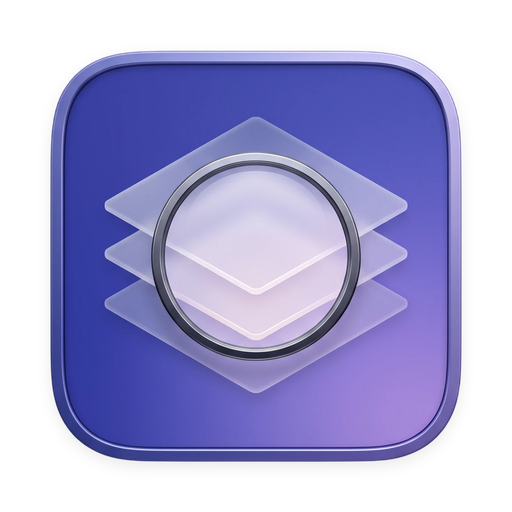

<p align="center">
  
</p>

# Inspector

**See what macOS hides.**

[](https://github.com/sadiqkhzn/Inspector/releases/latest/download/Inspector-0.3.0.dmg)


A native Mac app that shows you what's eating your disk, slowing your boot, and watching you — and lets you decide what to do. No scary scanner, no subscription, no cloud, no AI.

Built because the "95GB of System Data" screen in macOS Settings should not be the end of the conversation.

## Download

**[Inspector 0.3.0 for macOS (.dmg, 2.5 MB)](https://github.com/sadiqkhzn/Inspector/releases/latest/download/Inspector-0.3.0.dmg)**

Open the `.dmg`, drag `Inspector.app` to Applications. The build is ad-hoc signed (no paid Apple Developer certificate yet), so the first launch needs **right-click → Open** instead of a double-click — macOS remembers it after that.

SHA-256 of the `.dmg`:

```
d01f45af2791de637ebcbf19795088efaeb592ae59dfd652e1610c5e73b07f55
```

All releases are also available at [github.com/sadiqkhzn/Inspector/releases](https://github.com/sadiqkhzn/Inspector/releases).

## What's in v0.3.0

- **Storage** — ~185 catalog entries across caches, logs, dev-tool artefacts and installer leftovers. Each entry carries a safety tier (safe / review / keep), a plain-English explanation, and a provenance tag — `Verified` means cross-referenced against a primary source, `First-draft` means it hasn't been. Deletes go to the Trash and can be restored.
- **Boot** — scans `~/Library/LaunchAgents`, `/Library/LaunchAgents` and `/Library/LaunchDaemons`, grouped by developer. Each row shows the signer name taken from the executable's code signature and a plain schedule (`Every hour`, `Daily at 3:00`, `Mondays at 9:30`). Enabled items whose executable is unsigned get an `Unsigned` chip.
- **Permissions** — reads both TCC databases (requires Full Disk Access). One row per app with its real icon and a strip of System Settings glyphs for the permissions it holds. `By App` / `By Permission` toggle, `All / Sensitive / Allowed / Denied` filter, per-service deep-link into the right System Settings pane.
- Icon tabs in the toolbar, `⌘F` focuses search, `⌘R` rescans the active tab.
- 47 unit tests covering the catalog, env-var resolver, Boot plist parsing, Permissions tier logic, and the TCC SQLite parser.

## Principles

- **Clarity over cleanup.** Show what's there, in English, with a safety tier.
- **You decide.** Nothing is removed until you check a box and press a button.
- **Local only.** No network, no telemetry, no accounts, no AI.
- **No shell execution.** Everything happens through system APIs — no `codesign`, no `launchctl`, no `rm`.
- **Honest.** No "URGENT 97% FULL" scare tactics.

## Full Disk Access

The Permissions tab reads macOS's TCC privacy database, which lives under system-protected paths. To use it, grant Inspector **Full Disk Access** in **System Settings → Privacy & Security → Full Disk Access**. The Storage and Boot tabs work without it.

## Build from source

```bash
git clone https://github.com/sadiqkhzn/Inspector
cd Inspector
brew install xcodegen
xcodegen generate
open Inspector.xcodeproj
```

Minimum target: macOS 14 (Sonoma). Run the test suite with `xcodebuild test -scheme Inspector -destination 'platform=macOS'`.

## Roadmap

- [x] v0.1 — Storage view
- [x] v0.2 — Boot view (user agents, system agents, system daemons)
- [x] v0.3 — Permissions view (TCC database inspection)
- [ ] v0.4 — Menu bar companion for quick scans
- [ ] v1.0 — Notarised `.dmg` with a paid Apple Developer certificate

## Contributing

See [CONTRIBUTING.md](CONTRIBUTING.md) for scope, PR conventions, and catalog entry guidelines. All contributors are expected to follow the [Code of Conduct](CODE_OF_CONDUCT.md).

## License

MIT. See [LICENSE](LICENSE).
